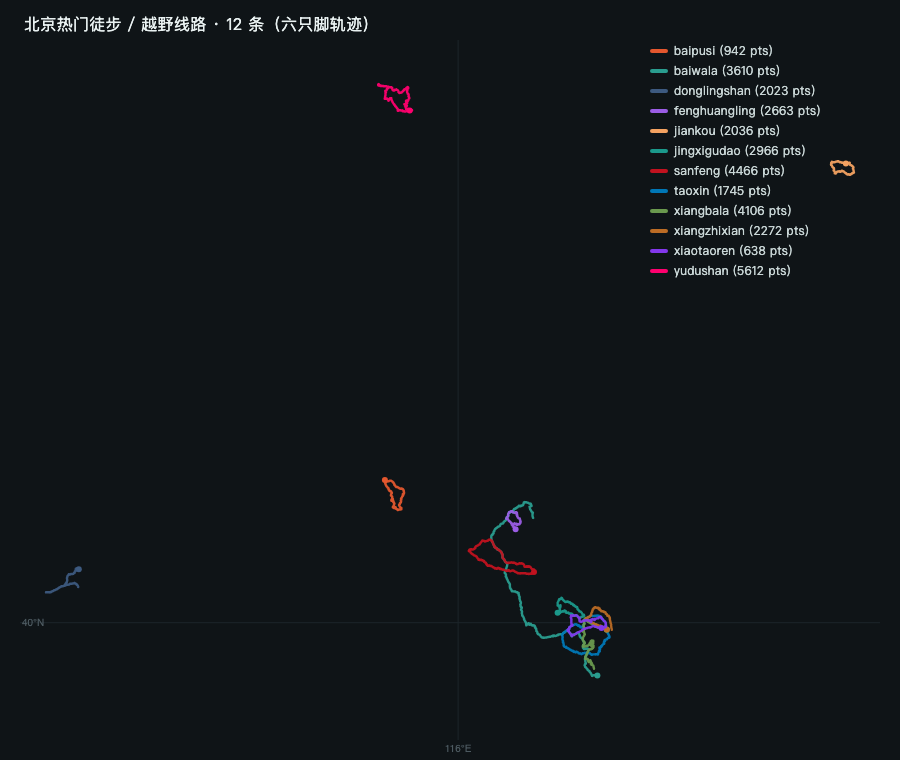
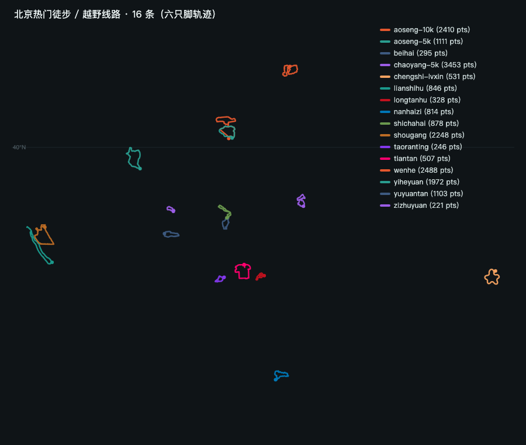

# 北京徒步 / 越野 / 公园跑步 路线 GPX（六只脚轨迹）

从 **六只脚（foooooot.com）** 抓取的 **28 条**北京热门线路原始轨迹，统一转成标准
**GPX 1.1**，可直接导入六只脚、两步路、Garmin、Suunto、OsmAnd、Gaia、Strava、Komoot。

- 山野徒步 / 越野 → 本目录，12 条
- 公园跑步 → `parks/`，16 条

## 山野徒步 / 越野（12 条）



| 路线 | 距离 | 爬升* | 海拔 | 轨迹点 | 文件 | 六只脚轨迹号 |
| --- | --- | --- | --- | --- | --- | --- |
| 三峰连穿（大觉寺·鹫峰·阳台山·妙峰山） | 21.09 km | +1898 m | 108–1278 m | 4466 | `sanfeng.gpx` | [100107125](https://www.foooooot.com/trip/100107125/) |
| 香八拉（香山→八大处） | 16.9 km | +1131 m | 83–673 m | 4106 | `xiangbala.gpx` | [10236323](https://www.foooooot.com/trip/10236323/) |
| 香山小桃人（“小桃仁”） | 14.91 km | +1103 m | 97–756 m | 638 | `xiaotaoren.gpx` | [10125202](https://www.foooooot.com/trip/10125202/) |
| 西山桃心（桃心线） | 19.51 km | +1253 m | 88–792 m | 1745 | `taoxin.gpx` | [4363143](https://www.foooooot.com/trip/4363143/) |
| 箭扣长城（西段） | 9.22 km | +777 m | 597–1000 m | 2036 | `jiankou.gpx` | [9985585](https://www.foooooot.com/trip/9985585/) |
| 京西古道小环线 | 11.41 km | +586 m | 176–603 m | 2966 | `jingxigudao.gpx` | [9983986](https://www.foooooot.com/trip/9983986/) |
| 凤凰岭环穿 | 10.89 km | +1047 m | 187–904 m | 2663 | `fenghuangling.gpx` | [10153715](https://www.foooooot.com/trip/10153715/) |
| 白八拉（毕业线） | 39.81 km | +3060 m | 44–1272 m | 3610 | `baiwala.gpx` | [1313256](https://www.foooooot.com/trip/1313256/) |
| 玉渡山·后河·应梦寺大环 | 22.14 km | +1252 m | 497–1123 m | 5612 | `yudushan.gpx` | [10119198](https://www.foooooot.com/trip/10119198/) |
| 东灵山主峰（北京最高峰） | 10.74 km | +778 m | 1485–2293 m | 2023 | `donglingshan.gpx` | [100071885](https://www.foooooot.com/trip/100071885/) |
| 白瀑寺环穿 | 13.12 km | +754 m | 442–809 m | 942 | `baipusi.gpx` | [9565481](https://www.foooooot.com/trip/9565481/) |
| 香植线（香山→植物园） | 10.06 km | +622 m | 64–631 m | 2272 | `xiangzhixian.gpx` | [99979765](https://www.foooooot.com/trip/99979765/) |

## 公园跑步（16 条）



“配速用时”按距离直接换算，不含等灯与爬升修正；“常见路面”是按各公园普遍路况的经验判断，**没有逐段核实**。
“闭合”是首尾两点的距离，越小越说明是一整圈。

| 跑道 | 距离 | 爬升* | 闭合 | 常见路面 | 5:00/km | 6:00/km | 7:00/km | 文件 | 六只脚轨迹号 |
| --- | --- | --- | --- | --- | --- | --- | --- | --- | --- |
| 奥森公园 · 南北园大圈 | 10.92 km | +85 m | 130 m | 塑胶跑道为主 | 54:36 | 1:05:31 | 1:16:26 | `parks/aoseng-10k.gpx` | [10191033](https://www.foooooot.com/trip/10191033/) |
| 奥森公园 · 南园 5 公里 | 5.28 km | +36 m | 54 m | 塑胶跑道为主 | 26:24 | 31:41 | 36:58 | `parks/aoseng-5k.gpx` | [8221904](https://www.foooooot.com/trip/8221904/) |
| 朝阳公园 · 5 公里健步道 | 4.93 km | +22 m | 44 m | 沥青步道 | 24:39 | 29:35 | 34:31 | `parks/chaoyang-5k.gpx` | [10030193](https://www.foooooot.com/trip/10030193/) |
| 城市绿心森林公园 | 6.21 km | +70 m | 51 m | 沥青绿道 | 31:03 | 37:16 | 43:28 | `parks/chengshi-lvxin.gpx` | [6931324](https://www.foooooot.com/trip/6931324/) |
| 莲石湖 · 冬奥公园环线 | 10.59 km | +86 m | 7 m | 沥青绿道 | 52:57 | 1:03:32 | 1:14:08 | `parks/lianshihu.gpx` | [4945599](https://www.foooooot.com/trip/4945599/) |
| 玉渊潭公园 · 大环线 | 4.05 km | +19 m | 2 m | 沥青环湖路 | 20:15 | 24:18 | 28:21 | `parks/yuyuantan.gpx` | [9901190](https://www.foooooot.com/trip/9901190/) |
| 紫竹院公园 · 环线 | 2.48 km | +31 m | 14 m | 沥青园路 | 12:24 | 14:53 | 17:22 | `parks/zizhuyuan.gpx` | [8510910](https://www.foooooot.com/trip/8510910/) |
| 颐和园环昆明湖 | 7.56 km | +25 m | 10 m | 石板 + 沥青 | 37:48 | 45:22 | 52:55 | `parks/yiheyuan.gpx` | [99908178](https://www.foooooot.com/trip/99908178/) |
| 天坛 · 外坛墙环线 | 7.03 km | +38 m | 62 m | 沥青外环道 | 35:09 | 42:11 | 49:13 | `parks/tiantan.gpx` | [9921413](https://www.foooooot.com/trip/9921413/) |
| 什刹海环湖 | 5.31 km | +88 m | 70 m | 石板 + 沥青 | 26:33 | 31:52 | 37:10 | `parks/shichahai.gpx` | [9704729](https://www.foooooot.com/trip/9704729/) |
| 北海公园环湖 | 4.10 km | +35 m | 58 m | 石板园路 | 20:30 | 24:36 | 28:42 | `parks/beihai.gpx` | [9163709](https://www.foooooot.com/trip/9163709/) |
| 南海子公园 | 4.69 km | +86 m | 22 m | 沥青绿道 | 23:27 | 28:08 | 32:50 | `parks/nanhaizi.gpx` | [10071451](https://www.foooooot.com/trip/10071451/) |
| 首钢园 10 公里 | 10.01 km | +38 m | 246 m | 沥青 | 50:03 | 1:00:04 | 1:10:04 | `parks/shougang.gpx` | [10108559](https://www.foooooot.com/trip/10108559/) |
| 温榆河公园（朝阳段） | 7.10 km | +13 m | 8 m | 沥青绿道 | 35:30 | 42:36 | 49:42 | `parks/wenhe.gpx` | [9669824](https://www.foooooot.com/trip/9669824/) |
| 龙潭湖公园环湖 | 3.80 km | +57 m | 13 m | 沥青园路 | 19:00 | 22:48 | 26:36 | `parks/longtanhu.gpx` | [8463463](https://www.foooooot.com/trip/8463463/) |
| 陶然亭公园 | 5.28 km | +36 m | 30 m | 沥青园路 | 26:24 | 31:41 | 36:58 | `parks/taoranting.gpx` | [9033357](https://www.foooooot.com/trip/9033357/) |

关于“标准圈”：这几条是按**公园官方/跑友常说的单圈长度**挑的——
奥森南北园大圈 ≈10.9 km、南园一圈 ≈5.3 km，天坛外坛墙一整圈 ≈7.0 km（天坛公园 1.6×1.6 km，绕墙一圈本就是这个数，
常说的“5.5 km”是内坛或估算），玉渊潭环湖 ≈4.0 km，紫竹院一圈 ≈2.5 km。
挑选时同时看了三项：闭合误差、轨迹到公园中心的最小距离（判断是不是真的绕外圈）、海拔跳变次数（判断数据干不干净）。

\* 爬升 = **海拔中值滤波 + 滑动平均去噪后**逐点累加。原始 GPS/气压海拔抖动很大，
不去噪直接累加会虚高 30%–50%（例如三峰原始值 2243 m，去噪后 1898 m；
白八拉 6133 m → 3060 m）。`manifest.json` 里同时保留了 `gain_raw_m`（原始值）。

## 文件说明

- `*.gpx` / `parks/*.gpx` —— GPX 1.1：`<trkpt>` 经纬度＋`<ele>` 海拔，除小桃人外都带 `<time>`；
  起终点另以 `<wpt>` 标出。**海拔为源数据原样，未做平滑**（去噪只用于 App 内的坡度分析）。
- `manifest.json` / `parks/manifest.json` —— 元数据（距离、爬升、海拔、点数、闭合距离、来源 URL）。
- `make_gpx.py` —— 抓取 + 转 GPX。改 `HIKING` / `PARKS` 里的轨迹号即可批量换线路。
- `build_app_data.py` —— 抽稀 + 去噪，生成 `app/js/routes.data.js`（App 内嵌用）。
- `overview.py [目录]` —— 生成总览图（`python3 overview.py parks` 画公园那组）。

## 已知问题 / 注意事项

1. **香山小桃人**：六只脚上的正式名是「追击小桃人」，“小桃仁”是同音俗称。
   该轨迹源数据只有一个时间戳，所以文件里省略了 `<time>`。
2. 数据是**用户实际 GPS 记录**，不是官方画线：含少量漂移和个别绕路。
   个别记录的海拔有硬伤——白八拉出现过 10 m 水平距离涨 372 m、城市绿心有 −6 m 的读数。
3. **直线量坡度会偏高**：轨迹点间距 5–70 m，弯道多的下坡按直线量会明显偏陡。
   三峰最陡的 400 m 段实测落差约 244 m（≈54%），是源轨迹本身的特征，
   不是算法错误——但请把它当“最陡一段有多陡”的量级参考，而不是精确坡度。
4. 白八拉、香八拉、东灵山是**穿越线**（首尾不重合），不是环线。
5. 公园组里的「城市绿心」纬度 39.87°N 属于通州，是六环外，离市区较远。

## 关于两步路（2bulu）

两步路站点挂着 SafeLine WAF，且**下载轨迹必须登录账号 + 过阿里滑块验证码**
（`/space/download_track.htm?trackId=…&type=3`）。匿名抓取不可行，用别人的账号自动下载也不合适。
要补齐两步路版本的话：你自己登录后导出 GPX/KML 发我，我来统一格式；或授权我用你已登录的浏览器会话批量拉。

## 复现 / 扩展

数据来自六只脚的公开接口（读轨迹点无需登录）：

```
搜索：GET https://www.foooooot.com/api/v3/trip/search/?keyword=三峰&bstr=115.41,39.44,117.51,41.06&page_num=0&length=0-100&order=-occurtime
轨迹：GET https://www.foooooot.com/v4/api/trip/<轨迹号>/trackjson        # [时间, 纬度, 经度, 海拔, 速度, 累计km]
页面：https://www.foooooot.com/trip/<轨迹号>/
```

注意：连续快速请求会被限流（表现为返回空），脚本里已加随机延迟；批量抓取请放慢。

```bash
python3 make_gpx.py          # 抓取 + 生成 GPX
python3 build_app_data.py    # 生成 app 内嵌数据
python3 overview.py parks    # 生成公园总览图
```

## 版权与使用

轨迹版权归各自上传者所有，此处仅作个人出行参考，请勿商用；引用时请保留六只脚轨迹号与链接。
进山请遵循当地管理规定，注意防火与安全。
